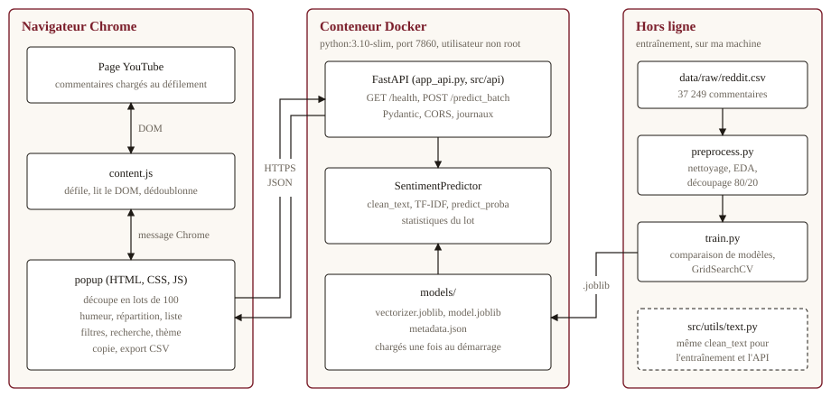
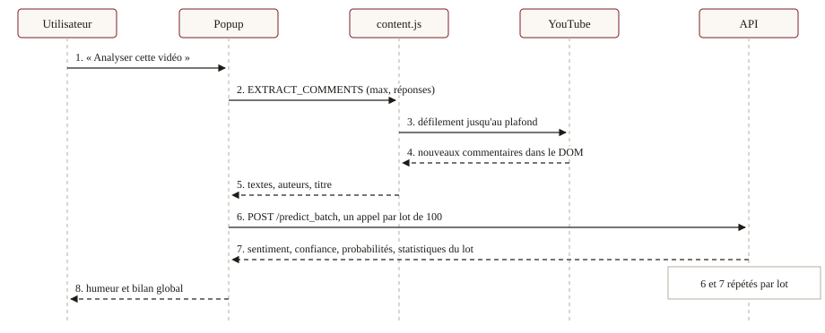
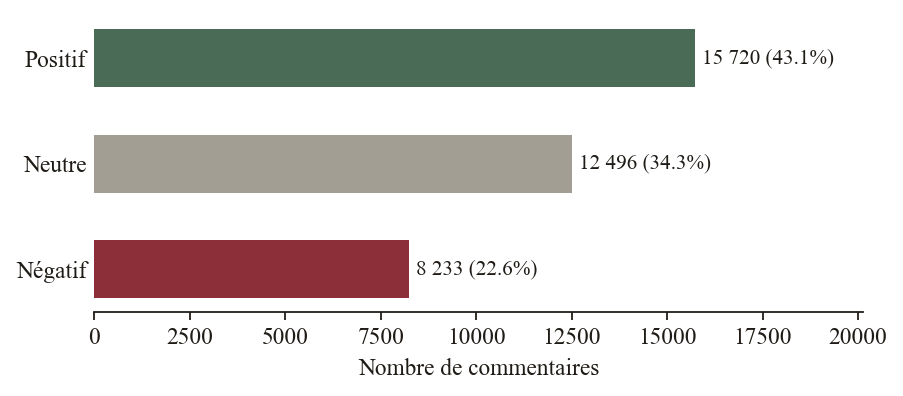
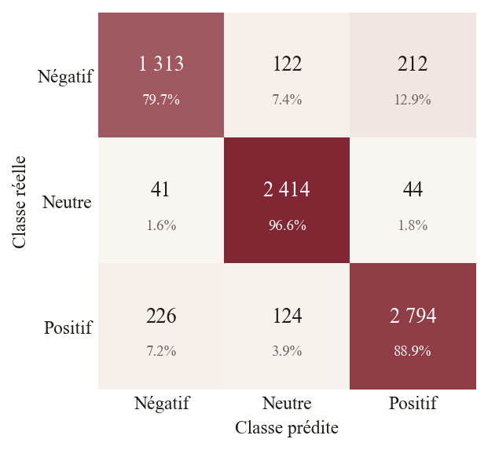

# Analyse de sentiment des commentaires YouTube

Zaid Hsain

---

## Introduction

Ce rapport présente le TP3 de Cloud Computing : un système qui lit les commentaires d'une vidéo YouTube, les classe en négatifs, neutres ou positifs, et affiche un bilan dans une extension Chrome. Le sujet couvre toute la chaîne d'un projet de machine learning, de la préparation des données à la mise à disposition du modèle derrière une API conteneurisée. Le plan suit les points demandés dans l'énoncé : analyse du problème, architecture, choix techniques, résultats, difficultés et améliorations. Les réponses aux questions de réflexion sont intégrées à la partie 3, et l'annexe indique où trouver chacune d'elles.

## 1. Analyse du problème et solution proposée

### 1.1 Le problème

Un créateur de contenu reçoit des centaines, parfois des milliers de commentaires. Les lire un par un prend trop de temps et ne passe pas à l'échelle. L'impression qu'on en retire dépend de ceux qu'on a lus et de son humeur du moment, et elle ne se chiffre pas, ce qui la rend peu utile pour décider de la suite d'une chaîne.

### 1.2 La solution

Le système comporte quatre briques : un modèle TF-IDF et régression logistique entraîné sur 36 449 commentaires, une API FastAPI qui sert ce modèle, une extension Chrome qui lit les commentaires de la vidéo ouverte et affiche le bilan, et une suite de tests. L'API est conteneurisée avec Docker et exposée depuis un GitHub Codespace, sur le port 7860 public.

### 1.3 État d'avancement

Tableau : État des livrables demandés

| Livrable | État |
|---|---|
| Code source, Dockerfile | Terminé, dépôt GitHub créé, image construite par GitHub Actions |
| Modèle et rapport de performance | Terminé (`models/`, `reports/`) |
| API | En ligne sur GitHub Codespaces, port 7860 public |
| Extension Chrome | Terminée, essayée sur de vraies vidéos YouTube ; guide utilisateur fourni |
| README et rapport | Terminés |
| Vidéo de démonstration | Terminée (5 min 03, sans voix) |

L'API répond à l'adresse `https://commentometre-api-97v7777w4q9cp6qp-7860.app.github.dev` tant que le Codespace tourne. Docker n'étant pas installé sur ma machine, l'image est construite et vérifiée par GitHub Actions (section 3.6).

## 2. Architecture détaillée

### 2.1 Vue d'ensemble

Les trois blocs ne communiquent que par des interfaces simples. Le navigateur envoie du JSON à l'API, et le conteneur ne reçoit de la partie hors ligne que les fichiers `.joblib`. La logique de prédiction (`src/api/predictor.py`) ne dépend pas de FastAPI, ce qui permet de la tester sans serveur. La fonction `clean_text` (`src/utils/text.py`) est le seul code commun à l'entraînement et à l'API : un texte est ainsi nettoyé de la même façon dans les deux cas.

### 2.2 Déroulement d'une analyse

### 2.3 Spécification de l'API

Tableau : Points d'entrée de l'API

| Route | Rôle | Réponse |
|---|---|---|
| `GET /health` | Surveillance | État, modèle chargé, version, durée de fonctionnement |
| `POST /predict_batch` | 1 à 500 commentaires | Classe, étiquette, confiance et probabilités par commentaire ; statistiques du lot ; temps de calcul |
| `GET /docs` | Documentation | Page Swagger générée par FastAPI |

Un lot vide, trop grand ou mal formé renvoie 422, un modèle absent renvoie 503, et une erreur inattendue renvoie 500 avec un message générique, le détail restant dans les journaux. Un commentaire de plus de 5 000 caractères est tronqué plutôt que rejeté.

## 3. Choix techniques justifiés

### 3.1 Environnement et versionnage

J'ai repris la structure de l'énoncé : `data/`, `models/`, `src/`, `chrome-extension/`, `logs/`, complétée par `tests/`, `reports/` et `docs/`. Chaque étape est un module exécutable, donc le projet se reproduit à partir d'un clone.

`data/raw` contient le fichier téléchargé, que je ne modifie jamais, et `data/processed` ce que les scripts en tirent. Si je change une règle de nettoyage, je régénère `processed` en gardant une source intacte, et je sais d'où viennent les données d'entraînement.

Le `.gitignore` exclut l'environnement virtuel (lourd et propre à ma machine), les données (régénérables), les journaux, les caches, et surtout les secrets comme un `.env` ou un token : un secret commité reste dans l'historique et doit être révoqué. Les fichiers du modèle sont versionnés, car ils pèsent environ 750 Ko et l'API en a besoin pour démarrer. Pour un modèle lourd, j'utiliserais Git LFS ou un registre de modèles.

L'environnement virtuel isole les dépendances et fige leurs versions. C'est ici indispensable, car un modèle enregistré avec joblib doit être relu avec les versions qui l'ont produit. J'utilise Python 3.10, comme l'image Docker.

### 3.2 Données

Le jeu de données compte 37 249 commentaires Reddit. Après retrait des 100 textes manquants, des textes vides et des doublons, il en reste 36 449 : 15 720 positifs, 12 496 neutres et 8 233 négatifs, soit bien plus que le minimum demandé.

Le nettoyage met le texte en minuscules, retire le HTML, les URL, les mentions, la ponctuation et les chiffres, garde le mot des hashtags et réduit les lettres répétées. Les URL et les mentions sont retirées parce qu'elles sont presque toutes uniques : elles gonfleraient le vocabulaire sans rien dire du sentiment. Les emojis sont en revanche traduits en mots avec la bibliothèque `emoji`, car ils portent souvent tout le sens d'un commentaire YouTube. La limite est que le corpus Reddit en contient peu.

Un commentaire neutre compte 7 mots en médiane, contre 21 pour un positif et 20 pour un négatif : un texte court a moins de chances de contenir un mot d'opinion. Le déséquilibre reste modéré (rapport de 1,9), je n'ai donc pas dupliqué de données et j'ai utilisé `class_weight="balanced"`. Son effet mesuré est faible (F1 de 0,868 sans, 0,870 avec).

Le découpage est de 80 % pour l'entraînement et 20 % pour le test, stratifié, avec une graine fixe. Ce ratio laisse 29 159 exemples pour apprendre et 7 290 pour évaluer, ce qui donne une accuracy précise à environ 0,7 point. Les hyperparamètres ont été choisis par validation croisée sur le jeu d'entraînement. La comparaison initiale des quatre algorithmes a en revanche utilisé le jeu de test : elle sert à orienter le choix, et il faut garder ce léger biais en tête.

### 3.3 Modèle

`CountVectorizer` donne le même poids à « the » et à « terrible ». TF-IDF réduit le poids des mots présents partout et met en avant les mots rares et caractéristiques. J'ai ajouté `sublinear_tf`, pour qu'un mot répété dix fois ne compte pas dix fois plus.

Tableau : Comparaison des algorithmes (même vectoriseur, jeu de test)

| Modèle | Accuracy | F1 macro | F1 le plus faible | Entraînement |
|---|---|---|---|---|
| SVM linéaire | 0,879 | 0,866 | 0,793 | 1,4 s |
| Régression logistique | 0,877 | 0,866 | 0,798 | 3,3 s |
| Forêt aléatoire | 0,773 | 0,713 | 0,476 | 13,2 s |
| Naive Bayes (complément) | 0,685 | 0,658 | 0,556 | 1,2 s |

La régression logistique et le SVM sont à égalité. J'ai gardé la première parce qu'elle fournit des probabilités, affichées comme confiance dans l'extension, alors que `LinearSVC` n'en donne pas.

Un `GridSearchCV` à trois plis, sur 24 combinaisons et avec le F1 macro comme critère, a retenu des mots seuls, 30 000 mots et C = 20. J'ai ensuite mesuré l'effet de chaque paramètre séparément.

Tableau : Effet des hyperparamètres (F1 macro en validation croisée)

| Paramètre | Valeurs testées et F1 |
|---|---|
| `C` | 1 : 0,836 · 5 : 0,865 · 10 : 0,868 · **20 : 0,870** · 50 : 0,868 · 100 : 0,868 |
| n-grammes (C = 20) | **mots seuls : 0,870** · 1-2 : 0,856 · 1-3 : 0,852 |
| `max_features` (C = 20) | 30 000 : 0,870 · 80 000 : 0,870 |

`C` est le paramètre le plus influent, puis la taille des n-grammes. Le nombre de mots retenus ne change rien.

### 3.4 API

FastAPI apporte la validation par Pydantic, des erreurs 422 détaillées et la documentation Swagger sans code supplémentaire, ce qu'il aurait fallu écrire à la main avec Flask.

CORS sert à dire au navigateur quelles origines ont le droit d'appeler l'API, car il bloque par défaut les appels vers un autre domaine. J'autorise les extensions Chrome, `localhost` et `youtube.com`. CORS ne protège que dans un navigateur et ne remplace pas une authentification : `curl` l'ignore.

Le modèle est chargé une seule fois au démarrage, grâce au `lifespan` de FastAPI, puis gardé en mémoire. Si le chargement échoue, l'API démarre quand même : `/health` indique « degraded » et `/predict_batch` répond 503.

### 3.5 Extension Chrome

L'extension utilise le Manifest V3 sans bibliothèque externe : la barre de répartition et les tuiles sont en HTML et CSS. Les commentaires sont insérés avec `textContent`, pour qu'un commentaire contenant du HTML ne soit jamais interprété.

YouTube charge les commentaires au fil du défilement. Le script se place sur la section des commentaires, attend le premier jusqu'à 12 secondes, puis fait défiler la page jusqu'à atteindre le plafond choisi (50 à 500) ou jusqu'à dix tentatives sans nouveauté. La page revient ensuite à sa position de départ.

Chaque fil (`ytd-comment-thread-renderer`) contient le commentaire et ses réponses dépliées. Le script les distingue et une option permet de les inclure. Elles sont exclues par défaut, car une réponse réagit souvent au commentaire parent plutôt qu'à la vidéo.

Pour rester fluide avec beaucoup de commentaires, l'extension les envoie par lots de 100, affiche la progression et insère la liste dans la page en une seule fois. Au-delà de quelques milliers, il faudrait virtualiser la liste.

### 3.6 Docker et déploiement

L'image part de `python:3.10-slim`, tourne avec un utilisateur non root d'identifiant 1000 et expose le port 7860. Les dépendances sont installées avant la copie du code : modifier une ligne de Python ne relance donc pas leur installation. Seuls `src/utils`, `src/api`, `models/` et `app_api.py` sont copiés. À chaque envoi sur GitHub, GitHub Actions construit l'image (564 Mo), lance le conteneur, interroge `/health` et vérifie trois prédictions.

`requirements-prod.txt` ne garde que ce qui sert le modèle, avec des versions exactes. pandas, matplotlib ou pytest n'ont rien à faire en production : les retirer allège l'image et réduit le nombre de paquets à surveiller. Pour aller plus loin, on pourrait exporter le modèle en ONNX et se passer de scikit-learn.

Le dossier `.devcontainer` prépare un GitHub Codespace en Python 3.10 : il installe les dépendances de production et lance l'API sur le port 7860. L'URL n'existe que pendant que le Codespace tourne, et le port repasse en privé à chaque redémarrage : le script `demarrer_api_cloud.sh` le rouvre avant une démonstration. Cela convient à une démonstration, pas à un service permanent.

Pour mettre à jour le modèle, j'incrémente sa version dans `metadata.json`, exposée par `/health`. Je réentraîne, je vérifie les tests, qui contrôlent les seuils de performance, je compare au modèle en place sur le même jeu de test, puis je pousse sur GitHub et je relance l'API dans le Codespace. Un `git revert` permet de revenir en arrière.

## 4. Résultats et métriques

### 4.1 Performances du modèle

Tableau : Modèle final sur les 7 290 commentaires de test

| Classe | Précision | Rappel | F1 |
|---|---|---|---|
| Négatif | 0,831 | 0,797 | 0,814 |
| Neutre | 0,908 | 0,966 | 0,936 |
| Positif | 0,916 | 0,889 | 0,902 |

L'accuracy est de **89,45 %** (80 % demandés), le F1 le plus faible de 0,814 (0,75 demandé) et un lot de 50 commentaires prend 0,7 ms (100 ms tolérées). Les trois critères sont respectés.

Les lignes sont les classes réelles et les colonnes les prédictions. Les neutres sont les mieux reconnus (96,6 %). L'erreur principale oppose positifs et négatifs : 438 commentaires, dont la longueur médiane est de 32 mots, contre 13 pour les commentaires bien classés. Ce sont donc surtout des textes longs, où le modèle doit trancher entre des mots de sens opposés.

### 4.2 Ce que le modèle a réellement appris

Les mots les plus influents m'ont intrigué : à côté de *hate* ou *great*, on trouve *other*, *down*, *more* ou *own*, qui n'expriment pas d'opinion. Ils ont pourtant une polarité dans le lexique de TextBlob (*more* : +0,5 ; *down* : −0,16). J'ai donc comparé directement : **le signe de la polarité TextBlob reproduit 100 % des 37 149 étiquettes**, sans une seule différence.

Les étiquettes viennent donc de TextBlob et non d'annotateurs humains. Cela change la lecture du score : 89,45 % mesure l'accord avec TextBlob, pas avec un lecteur, et TextBlob lui-même obtiendrait 100 % sur ce test. Cela explique aussi que les bigrammes n'aident pas, TextBlob raisonnant surtout mot à mot, et que « not bad at all » soit classé négatif. Sur mes exemples de test, « *Disappointing, expected much more depth* » sort positif, et « *Dark mode editor theme name?* » sort négatif.

### 4.3 API et tests

Les 38 tests pytest passent sur ma machine, et GitHub Actions les relance à chaque envoi, sauf le contrôle des seuils sur le jeu de test, qui demande les données. Ils couvrent le nettoyage, le modèle (seuils de l'énoncé, cas limites, latence) et l'API (tailles de lot, requêtes invalides, CORS, modèle absent). Le script `integration_check.py` vérifie une API réelle : en local, tous ses contrôles passent, dont la cohérence entre l'API et le modèle chargé directement.

Tableau : Temps de réponse de l'API (aller-retour, médiane de 5 appels)

| Lot | 10 | 50 | 100 | 500 |
|---|---|---|---|---|
| En local | 3,1 ms | 3,4 ms | 5,1 ms | 17,1 ms |
| En ligne (Codespaces) | 364 ms | 234 ms | 266 ms | 390 ms |

En ligne, la latence réseau domine : le temps varie peu avec la taille du lot. Le même script confirme que l'API publique donne les mêmes prédictions que le modèle local.

Le test `run_e2e.py` pilote l'extension dans Chromium sur une page qui reproduit la structure des commentaires YouTube, avec 60 commentaires fictifs arrivant par paquets. Les 60 sont lus, 63 avec les réponses, les filtres, la recherche, le thème, la copie et le CSV fonctionnent, et une API coupée produit un message clair. J'ai relu ces 60 prédictions : 57 correspondent au sentiment que j'attendais.

### 4.4 Essais sur de vraies vidéos

Tableau : Analyses de vraies vidéos YouTube (plafond de 100 commentaires, 200 avec réponses pour *Gangnam Style*)

| Vidéo | Commentaires | Positifs | Neutres | Négatifs | Score |
|---|---|---|---|---|---|
| *Daily English Conversations About Emergencies & Safety* | 96 | 51,0 % | 43,8 % | 5,2 % | +0,46 |
| PSY, *Gangnam Style* | 197 | 23,4 % | 70,6 % | 6,1 % | +0,17 |
| Rick Astley, *Never Gonna Give You Up* | 99 | 30,3 % | 61,6 % | 8,1 % | +0,22 |
| Documentaire en arabe et en darija | 100 | 6,0 % | 93,0 % | 1,0 % | +0,05 |

| Résultat, thème clair | Thème sombre |
|---|---|
|  |  |

L'extension lit bien de vrais commentaires, et l'appel à l'API publique prend quelques centaines de millisecondes. Les chiffres varient légèrement d'une analyse à l'autre, car les commentaires affichés changent. Ces résultats sont à lire avec prudence. La part de neutres est élevée, en partie parce que beaucoup de commentaires sont des blagues sans mot d'opinion. La dernière ligne montre surtout que le modèle ne comprend pas l'arabe : ces 93 % de neutres ne disent rien de l'accueil réel de la vidéo. Le popup a été ouvert dans sa propre fenêtre pour ces essais, et je n'ai pas évalué la justesse de ces prédictions faute d'annotation.

## 5. Difficultés rencontrées et solutions

Tableau : Principales difficultés

| Difficulté | Cause | Solution |
|---|---|---|
| L'API ne démarrait pas avec les seules dépendances de production (`ModuleNotFoundError: pandas`) | `clean_text` était dans un fichier qui importe pandas ; en local, pandas masquait le problème | Déplacement dans `src/utils/text.py`, sans dépendance lourde |
| numpy 2.4 indisponible pour Python 3.10, version de l'image | J'avais commencé en Python 3.11 | Environnement recréé en 3.10, modèle réentraîné (mêmes résultats sur le test), versions figées |
| « Aucun commentaire trouvé », ou bilan limité à 20 commentaires | L'extension abandonnait après 3,6 s sans nouveauté | Attente du premier commentaire, patience accrue, léger défilement vers le haut pour relancer le chargement |
| Codespace en échec, puis API absente au démarrage | Module docker-in-docker non installable ; processus tué en fin de démarrage | Module retiré ; script `start_api.sh` qui détache l'API |
| Score élevé, mais erreurs absurdes | Étiquettes produites par TextBlob | Vérification sur tout le jeu de données, limite documentée |
| Pas de Docker sur ma machine | Image impossible à construire en local | Essai dans un environnement vierge, puis construction et test de l'image par GitHub Actions |
| Le port 8000 était déjà occupé | Un autre service local | API de développement sur le port 8001 |

La première difficulté a été la plus instructive : tout marchait sur ma machine, et seul un essai dans un environnement dépouillé pouvait révéler le problème.

## 6. Améliorations futures

La priorité concerne les données. Tant que les étiquettes viennent de TextBlob, aucun modèle entraîné dessus ne mesure un vrai jugement. Il faudrait annoter à la main quelques milliers de vrais commentaires YouTube, en anglais mais aussi en français, en arabe et en darija, puis évaluer le modèle dessus.

Côté modèle, on pourrait traiter les négations, puis essayer un petit transformer multilingue comme XLM-R, exporté en ONNX pour rester rapide. Il faudrait aussi vérifier la calibration des probabilités : avec C = 20, le modèle affiche souvent une confiance très élevée.

Côté MLOps, il faudrait passer à un hébergement permanent, avec un suivi des expériences par MLflow et une surveillance de la dérive des données. Une clé d'API limiterait les abus. Enfin, l'API officielle YouTube Data v3 permettrait de récupérer tous les commentaires sans faire défiler la page.

## Conclusion

Le système fonctionne de bout en bout : un clic suffit pour lire les commentaires d'une vidéo et obtenir un bilan en quelques secondes, et le modèle dépasse les trois seuils de l'énoncé. L'image Docker est construite et vérifiée, et l'API est accessible publiquement. Je retiens surtout deux leçons : un bon score ne vaut que ce que valent les étiquettes, et un code qui marche sur ma machine n'est pas encore prouvé tant qu'il n'a pas tourné dans un environnement proche de la production.

## Annexe : questions de réflexion

Tableau : Où trouver la réponse à chaque question de l'énoncé

| Phase | Questions | Section |
|---|---|---|
| 1 | Données raw et processed ; fichiers à ne pas commiter ; environnement virtuel | 3.1 |
| 2 | URL et mentions ; emojis ; ratio train/test | 3.2 |
| 3 | TF-IDF ou comptage ; hyperparamètres | 3.3 |
| 3 | Lecture de la matrice de confusion | 4.1 |
| 4 | FastAPI ou Flask ; CORS ; chargement du modèle | 3.4 |
| 5 | Réponses (threads) ; commentaires dynamiques ; performances | 3.5 |
| 6 | Dépendances dev et prod ; taille de l'image ; mises à jour du modèle | 3.6 |
