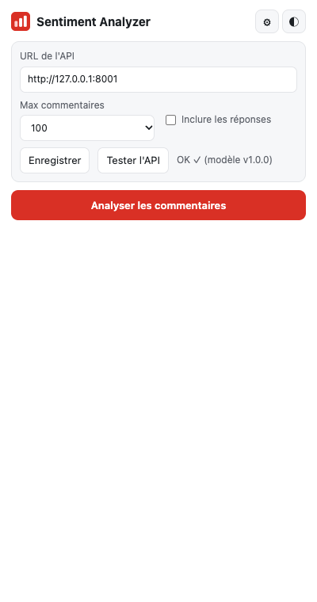
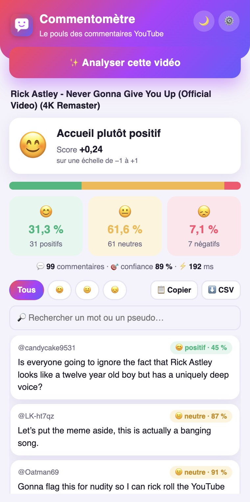
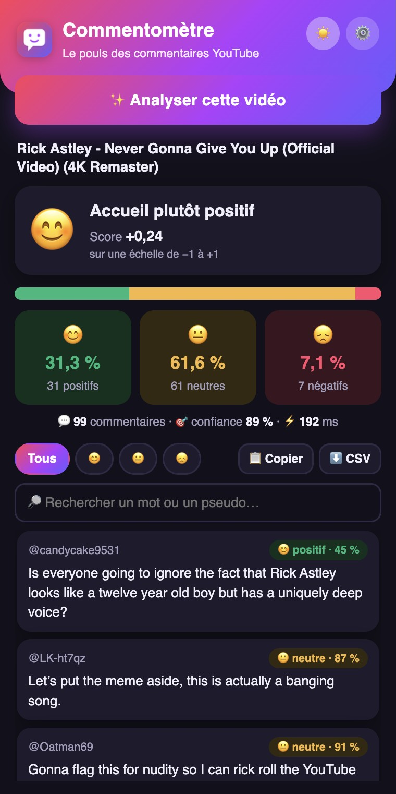

# Guide utilisateur du Commentomètre

## Installation

1. Décompresser `chrome-extension.zip`, ou utiliser le dossier `chrome-extension/`.
2. Ouvrir `chrome://extensions` dans Chrome et activer le **Mode développeur**, en haut à droite.
3. Cliquer sur **Charger l'extension non empaquetée** et choisir ce dossier.
4. Cliquer sur l'icône de puzzle à droite de la barre d'adresse, puis épingler **Commentomètre**.

## Connexion à l'API

Ouvrir les réglages (⚙️), coller l'adresse de l'API, cliquer sur **Enregistrer**, puis sur **Tester l'API**. Un message confirme que le modèle est chargé. On choisit aussi ici le nombre de commentaires à lire, et si les réponses sont incluses.

## Analyser une vidéo

1. Ouvrir une vidéo YouTube. Le modèle a été entraîné en anglais : ses résultats ne sont pas fiables sur d'autres langues.
2. Cliquer sur l'icône de l'extension, puis sur **Analyser cette vidéo**.
3. Laisser la page défiler toute seule quelques secondes, puis lire le bilan.

## Lire le résultat

L'emoji et la phrase résument l'humeur générale. Le score va de −1 (tout négatif) à +1 (tout positif). La barre et les trois tuiles donnent la répartition. Viennent ensuite le nombre de commentaires, la confiance moyenne et le temps de réponse de l'API.

## Les fonctions

| Fonction | Utilisation |
|---|---|
| Filtres | **Tous**, 😊, 😐 ou 😞 n'affichent que le sentiment choisi |
| Recherche | Filtre par mot ou par pseudo |
| Mode sombre | Bouton 🌙 ou ☀️, le choix est mémorisé |
| Copier | Copie le résumé et la liste affichée |
| CSV | Télécharge les résultats, lisibles dans Excel |

## En cas de problème

| Message | Que faire |
|---|---|
| Impossible de joindre l'API | Vérifier l'adresse dans les réglages, et que l'API ou le Codespace tourne |
| Aucun commentaire trouvé | Vérifier que la vidéo accepte les commentaires, puis relancer l'analyse |
| Ouvrez d'abord une vidéo YouTube | L'onglet actif n'est pas une page de vidéo |
