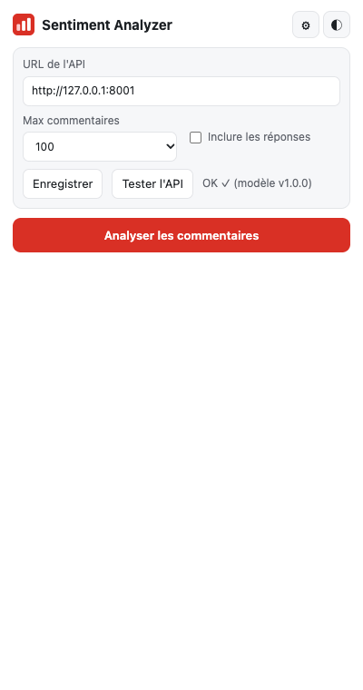
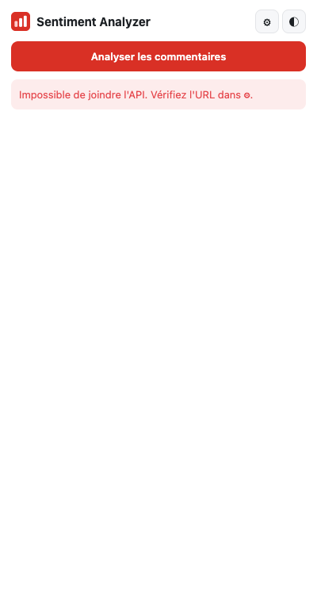

# Rapport technique — Analyse de sentiment des commentaires YouTube

**TP3 Cloud Computing — Filière INDIA, ENSAM Rabat — Prof. Maria Zemzami — 2026/27**

**Réalisé par :** _Nom Prénom_ — **Dépôt GitHub :** {{GITHUB_URL}} — **API :** {{API_URL}}

---

## 1. Problème et solution proposée

Un créateur YouTube reçoit des centaines de commentaires. Les lire tous pour mesurer la réception
d'une vidéo est lent, subjectif et non quantifiable.

**Solution** : un système MLOps de bout en bout.

1. Un **modèle** de classification (TF-IDF + régression logistique) entraîné sur 36 000 commentaires labelisés.
2. Une **API REST** FastAPI qui sert le modèle, conteneurisée avec Docker et hébergée sur Hugging Face Spaces.
3. Une **extension Chrome** qui extrait les commentaires de la vidéo ouverte, interroge l'API et affiche
   une synthèse visuelle.
4. Une **suite de tests** (38 tests unitaires et d'API + un test d'intégration contre l'API déployée).

## 2. Architecture

Voir le schéma du `README.md`. Flux d'une analyse :

| Étape | Où | Quoi |
|---|---|---|
| 1 | Navigateur | L'utilisateur ouvre une vidéo et clique sur l'extension |
| 2 | `content.js` | Fait défiler la page pour charger les commentaires (lazy loading), lit le DOM |
| 3 | `popup.js` | Découpe en lots de 100 et envoie `POST /predict_batch` |
| 4 | API | Pydantic valide → `clean_text` → TF-IDF → `predict_proba` |
| 5 | API | Renvoie sentiment, confiance, probabilités et statistiques agrégées |
| 6 | `popup.js` | Affiche le donut, les KPI, la liste filtrable ; copie / export CSV |

**Séparation des responsabilités** dans le code :

- `src/utils/text.py` : nettoyage de texte, **seul module partagé** entre entraînement et API.
- `src/api/predictor.py` : logique ML pure (chargement, prédiction, statistiques), testable sans HTTP.
- `src/api/main.py` : couche HTTP (routes, CORS, erreurs, logs).
- `app_api.py` : point d'entrée de production (port 7860 via `PORT`).

## 3. Phase 1 — Environnement MLOps

Structure `data/ models/ src/ chrome-extension/ logs/ reports/ tests/`, dépôt Git, environnement virtuel
Python 3.10, `requirements.txt` (dev) et `requirements-prod.txt` (prod), `.gitignore`.

**Pourquoi séparer `raw` et `processed` ?**
`raw` est la source de vérité immuable ; `processed` est un artefact régénérable par script. On peut
modifier le nettoyage et tout recalculer sans jamais retélécharger ni écraser l'original : c'est la
condition de la reproductibilité et de la traçabilité.

**Quels fichiers ne jamais committer ?**
Secrets (`.env`, tokens HF/GitHub), environnement virtuel (`.venv/`, des centaines de Mo et propre à
une machine), données volumineuses ou régénérables (`data/`), caches (`__pycache__`), logs, fichiers
d'IDE/OS. Les modèles `.joblib` (≈ 750 Ko ici) sont versionnés car le Space en a besoin ; au-delà de
quelques dizaines de Mo, on utiliserait Git LFS, DVC ou le Hub de modèles HF.

**Importance de l'environnement virtuel ?**
Isoler les dépendances du projet (pas de conflit avec d'autres projets ou le Python système) et figer
les versions. C'est critique ici : un modèle sérialisé avec joblib doit être rechargé avec la même
version de scikit-learn (voir § 9).

## 4. Phase 2 — Données

**Source** : `reddit.csv` (Himanshu-1703), 37 249 lignes, colonnes `clean_comment`, `category`.

| Étape | Lignes |
|---|---|
| Brut | 37 249 |
| Après suppression des NaN (100), textes vides et doublons | **36 449** |
| Train (80 %) / Test (20 %) | 29 159 / 7 290 |

Distribution : positif 43 % (15 720), neutre 34 % (12 496), négatif 23 % (8 233). Les exigences du TP
(≥ 1 000 commentaires, ≥ 300 par classe, colonnes `text`/`label`) sont largement satisfaites.

{width=48%} {width=50%}

**EDA** (`reports/figures/`) : les commentaires neutres sont beaucoup plus courts (médiane 7 mots)
que les positifs (21) et négatifs (20). Un texte court contient peu de mots porteurs d'opinion, d'où
une prédiction « neutre ».

**Nettoyage** (`clean_text`) : minuscules, suppression HTML, URLs, mentions `@`, `#hashtag` → `hashtag`,
emojis convertis en mots, apostrophes retirées (`don't` → `dont`), suppression chiffres/ponctuation,
lettres répétées réduites (`soooo` → `soo`), espaces normalisés.

**Déséquilibre** : modéré (ratio 1,9 entre la plus grande et la plus petite classe). Traité par
`class_weight="balanced"` (la perte pondère davantage les erreurs sur la classe négative) plutôt que
par sur-échantillonnage, qui dupliquerait des textes et gonflerait artificiellement le train.

**Split** : `train_test_split(test_size=0.2, stratify=label, random_state=42)` → reproductible et
proportions de classes identiques dans train et test.

**Pourquoi nettoyer URLs et mentions ?**
Ce sont des tokens quasi uniques (chaque URL, chaque pseudo est différent) : ils gonflent le vocabulaire,
ne portent aucun sentiment et favorisent le sur-apprentissage sur des identifiants.

**Comment gérer les emojis ?**
Les supprimer ferait perdre un signal fort sur YouTube (😍, 😡, 😂). On les convertit en texte
(`emoji.demojize` : 😍 → « smiling face with heart eyes »), ce qui les rend exploitables par TF-IDF.
Limite : le dataset Reddit contient peu d'emojis, donc le modèle en a peu appris ; un dataset YouTube
ou un dictionnaire emoji → sentiment ferait mieux.

**Quel ratio train/test ?**
80/20 est le compromis standard pour quelques dizaines de milliers d'exemples : 7 000 exemples de test
donnent une estimation stable (intervalle de confiance ≈ ±0,7 point sur l'accuracy), et 29 000 restent
pour l'entraînement. La validation croisée (3-fold) sur le train sert au réglage des hyperparamètres,
le test n'est utilisé qu'une fois à la fin.

## 5. Phase 3 — Modèle

**Démarche** : (1) comparer 4 algorithmes avec le même TF-IDF ; (2) optimiser TF-IDF + régression
logistique par `GridSearchCV` (24 combinaisons × 3 folds, métrique F1 macro) ; (3) évaluer une seule
fois sur le test ; (4) sauvegarder vectoriseur et modèle avec `joblib`.

| Modèle | Accuracy | F1 macro | F1 min. | Entraînement |
|---|---|---|---|---|
| LinearSVC | 0,879 | 0,866 | 0,793 | 1,4 s |
| **Logistic Regression** | 0,877 | 0,866 | 0,798 | 3,3 s |
| Random Forest | 0,773 | 0,713 | 0,476 | 13,2 s |
| Complement NB | 0,685 | 0,658 | 0,556 | 1,2 s |

La régression logistique fait jeu égal avec le SVM linéaire et a un avantage décisif pour le produit :
elle fournit des **probabilités calibrées** (`predict_proba`), affichées comme « confiance » dans
l'extension. Random Forest est mal adapté aux matrices TF-IDF très creuses et de grande dimension.

**Grille et meilleur résultat** : `ngram_range ∈ {(1,1),(1,2),(1,3)}`, `max_features ∈ {30k, 80k}`,
`C ∈ {1, 5, 10, 20}` → meilleurs : **unigrammes, 30 000 features, C = 20** (F1 CV = 0,870).

**Résultats finaux sur le test set** :

| | Précision | Rappel | F1 |
|---|---|---|---|
| Négatif | 0,831 | 0,797 | 0,814 |
| Neutre | 0,908 | 0,966 | 0,936 |
| Positif | 0,916 | 0,889 | 0,902 |
| **Accuracy** | | | **0,8945** |

Latence : **0,7 ms** pour 50 commentaires (critère : < 100 ms). Tous les critères du TP sont atteints.

**Pourquoi TF-IDF plutôt que CountVectorizer ?**
CountVectorizer compte les occurrences brutes : les mots fréquents partout (« the », « video ») dominent.
TF-IDF pondère chaque mot par sa rareté dans le corpus (IDF) : un mot présent dans tous les documents
pèse presque zéro, un mot discriminant pèse fort. Avec `sublinear_tf` (1 + log tf) et la normalisation
L2, un commentaire long ne domine pas un commentaire court. Pour un modèle linéaire, cela donne des
features mieux échelonnées et une convergence plus stable.

**Interprétation de la matrice de confusion**

{width=55%}

Lignes = vraie classe, colonnes = prédiction, diagonale = bonnes réponses.

| Réel \ Prédit | Négatif | Neutre | Positif |
|---|---|---|---|
| Négatif | **1 313** | 122 | 212 |
| Neutre | 41 | **2 414** | 44 |
| Positif | 226 | 124 | **2 794** |

- La classe neutre est la mieux reconnue (rappel 96,6 %).
- La confusion principale est **négatif ↔ positif** (212 + 226) : ce sont des commentaires longs qui
  mélangent des mots positifs et négatifs ; le modèle sac-de-mots ne sait pas lequel l'emporte.
- La classe négative a le plus faible rappel (79,7 %) : c'est la classe minoritaire.

**Hyperparamètres les plus influents**
1. `C` (inverse de la régularisation) : le plus déterminant. Trop faible, le modèle ignore les mots
   rares mais porteurs de sentiment ; la meilleure valeur est en bord de grille (20), on pourrait donc
   explorer au-delà.
2. `ngram_range` : contre-intuitivement, les unigrammes battent les bigrammes (voir ci-dessous).
3. `class_weight="balanced"` : améliore le rappel de la classe négative.
4. `max_features`, `min_df`, `sublinear_tf` : effet plus faible.

**Constat important sur les labels.** Les mots les plus influents du modèle sont :

- négatif : *hate, stupid, **other**, bad, **down**, evil, pathetic, worst, wrong, **mean**, **game***
- positif : ***more**, best, good, lol, great, **right**, **own**, **many**, **most**, better, **kind***

« other », « down », « more », « own », « many » n'expriment pas une opinion : ce sont exactement les mots
du lexique de polarité **TextBlob**. Les labels du dataset ont donc été produits automatiquement par
TextBlob et non annotés par des humains. Le modèle réapprend ce lexique, ce qui explique :
la bonne accuracy (la tâche est quasi déterministe), la victoire des unigrammes (TextBlob travaille
mot à mot), et des erreurs comme « not bad at all » classé négatif. Le test de bout en bout (§ 9)
le confirme : « *Disappointing, expected much more depth* » est classé **positif** (« more » est positif
pour TextBlob) et « *Dark mode editor theme name?* » **négatif** (« dark » est négatif pour TextBlob). Ce point doit être dit honnêtement :
**89 % d'accord avec TextBlob ne signifie pas 89 % d'accord avec un humain**.

## 6. Phase 4 — API REST

| Endpoint | Méthode | Rôle |
|---|---|---|
| `/health` | GET | État de l'API, modèle chargé, version, uptime |
| `/predict_batch` | POST | 1 à 500 commentaires → prédictions + statistiques + temps de calcul |
| `/docs` | GET | Documentation Swagger générée automatiquement |

Validation Pydantic (liste non vide, ≤ 500 éléments, chaînes uniquement, troncature à 5 000 caractères),
erreurs 422 / 503 / 500 explicites, journalisation de chaque requête (méthode, chemin, statut, durée)
dans la console et `logs/app.log`.

**Pourquoi FastAPI plutôt que Flask ?**
Validation et sérialisation automatiques par les types (Pydantic) au lieu de code manuel ;
documentation OpenAPI/Swagger générée gratuitement (livrable « documentation API ») ; serveur ASGI
plus performant ; erreurs 422 détaillées. Flask resterait possible mais demanderait d'écrire à la main
ce que FastAPI fournit.

**À quoi sert CORS ?**
Le navigateur bloque par défaut une page qui appelle un autre domaine que le sien (*Same-Origin
Policy*). CORS permet au serveur de déclarer quelles origines sont autorisées. Ici on autorise les
origines `chrome-extension://<id>`, `localhost` et `youtube.com`, et rien d'autre. Un site
malveillant ne peut donc pas utiliser l'API depuis le navigateur d'un visiteur. CORS ne remplace
pas une authentification : `curl` l'ignore.

**Comment charger le modèle efficacement ?**
Une seule fois au démarrage (hook `lifespan` de FastAPI), conservé en mémoire, puis réutilisé par
toutes les requêtes. Charger à chaque requête coûterait des dizaines de millisecondes et de la mémoire.
Si le chargement échoue, l'API démarre quand même en mode dégradé : `/health` le signale et
`/predict_batch` renvoie 503 au lieu de planter.

## 7. Phase 5 — Extension Chrome

Manifest V3, permissions minimales : `activeTab`, `scripting`, `storage`, et accès hôte limité à
YouTube, `*.hf.space` et localhost. Aucune bibliothèque externe : le donut est dessiné en SVG
(les extensions MV3 interdisent le chargement de scripts distants).

Fonctionnalités : extraction automatique avec défilement, statistiques globales (%, effectifs, score,
confiance moyenne, temps de réponse), liste avec sentiment et confiance, filtres, recherche,
mode sombre/clair mémorisé, copie des résultats, export CSV, gestion du chargement et des erreurs
(API injoignable, délai dépassé, page non YouTube, aucun commentaire). Sécurité : les commentaires sont
insérés avec `textContent`, jamais `innerHTML`, pour qu'un commentaire contenant du HTML ou du script
ne soit pas exécuté (XSS).

| Résultats (mode clair) | Filtre « Positifs » (mode sombre) |
|---|---|
| {width=95%} | {width=95%} |

| Filtre « Négatifs » | Paramètres et test de l'API | Erreur réseau |
|---|---|---|
| {width=95%} | {width=95%} | {width=95%} |

**Comment gérer les threads (réponses) ?**
Chaque `ytd-comment-thread-renderer` contient le commentaire principal puis, dans
`ytd-comment-replies-renderer`, les réponses dépliées. Le content script les distingue (`isReply`) ;
une option permet de les inclure ou non, et elles sont marquées « réponse » dans la liste. Par défaut
on ne les inclut pas : elles réagissent souvent au commentaire parent plutôt qu'à la vidéo.

**Comment extraire des commentaires chargés dynamiquement ?**
YouTube ne charge les commentaires qu'au défilement. Le content script fait défiler la page jusqu'en bas,
attend environ 0,9 s, recompte, et s'arrête quand le nombre demandé est atteint ou après 4 itérations
sans nouveau commentaire. Il revient ensuite à la position initiale. Les doublons sont filtrés. Si le
script n'est pas présent (onglet ouvert avant l'installation), le popup l'injecte avec
`chrome.scripting`.

**Comment rester performant avec beaucoup de commentaires ?**
Plafond configurable (50–500), envoi en lots de 100 pour limiter la taille des requêtes et afficher
la progression, statistiques agrégées côté client, rendu de la liste via un `DocumentFragment` (une
seule insertion dans le DOM), zone de liste à hauteur fixe défilante. Pour aller plus loin :
virtualisation de la liste et cache des résultats par vidéo.

## 8. Phase 6 — Déploiement Docker / Hugging Face

- `python:3.10-slim`, utilisateur non-root UID 1000 (exigé par HF), port **7860**.
- Couches ordonnées pour le cache : `requirements-prod.txt` puis `pip install` **avant** la copie du
  code. Modifier le code ne relance pas l'installation des dépendances.
- On ne copie que `src/utils`, `src/api`, `models/`, `app_api.py`. `.dockerignore` exclut données,
  tests, extension, venv et `.git`.
- `HEALTHCHECK` sur `/health`.
- Le même dépôt Git a deux remotes : `origin` (GitHub) et `hf` (Space). Le bloc YAML du README
  configure le Space (`sdk: docker`, `app_port: 7860`).

**Pourquoi séparer requirements dev et prod ?**
L'image de production n'a besoin que de servir le modèle. pandas, matplotlib, seaborn, pytest ne
servent qu'à préparer les données, entraîner et tester. Les retirer réduit la taille de l'image, le
temps de build et de démarrage, et la surface d'attaque (moins de paquets à surveiller pour les
failles). Les versions de prod sont **figées** à l'identique de l'environnement d'entraînement.

**Comment réduire la taille de l'image ?**
Image `slim` (≈ 50 Mo au lieu de ≈ 1 Go pour l'image complète) ; `PIP_NO_CACHE_DIR` ; dépendances
minimales ; `.dockerignore` strict ; modèle compressé (`joblib.dump(..., compress=3)`, ≈ 750 Ko).
Pour aller plus loin : *multi-stage build* (compiler dans un étage, ne copier que le résultat) ou
export ONNX pour se passer de scikit-learn/scipy.

**Quelle stratégie pour les mises à jour du modèle ?**
Version dans `models/metadata.json`, exposée par `/health` et chaque réponse. Le cycle est :
ré-entraînement → la CI vérifie que les tests (dont les seuils de performance) passent → on compare
au modèle en production sur le même test set → nouveau commit / tag → `git push hf` reconstruit
l'image. Si le build ou le healthcheck échoue, l'ancienne version reste en ligne, et revenir en
arrière se fait par `git revert`. À plus grande échelle : stocker les modèles sur le Hub HF ou dans
un registre (MLflow), déploiement *canary*, surveillance de la dérive des données.

## 9. Phase 7 — Tests et validation

`pytest` : **38 tests, tous verts.**

| Fichier | Contenu |
|---|---|
| `test_preprocessing.py` | URLs, mentions, hashtags, emojis, ponctuation, contractions, HTML, entrées vides ou non textuelles |
| `test_model.py` | Seuils du TP sur le test set (accuracy ≥ 0,8, F1 > 0,75 par classe), cas évidents, cas limites (vide, très court, emojis seuls, 18 000 caractères, langues mélangées, ponctuation seule), latence < 100 ms, cohérence des statistiques |
| `test_api.py` | `/health`, lots de 1 à 500, conservation du texte original, 6 payloads invalides → 422, JSON malformé, mauvaise méthode → 405, CORS accepté (extension) / refusé (origine inconnue), temps de réponse, modèle absent → 503 |
| `integration_check.py` | Contre une API réelle (locale ou HF) : health, prédiction, **cohérence local/distant**, erreurs, temps de réponse par taille de lot |

Mesures sur l'API locale : 2,3 ms (lot de 10), 3,1 ms (50), 4,4 ms (100), 13,9 ms (500), aller-retour
compris. Sur Hugging Face, ajouter la latence réseau (≈ 100–300 ms) et le réveil d'un Space en
veille (jusqu'à environ 30 s au premier appel ; c'est pourquoi l'extension attend jusqu'à 30 s).

**Test de bout en bout automatisé** (`tests/e2e/run_e2e.py`, Playwright + Chromium) : l'extension
réelle est chargée dans Chromium, le popup interroge l'API réelle, et le content script lit une page
servie à l'adresse `youtube.com/watch` qui reproduit la structure DOM des commentaires YouTube.
YouTube ne charge pas ses commentaires dans un navigateur automatisé, d'où cette page de test ; tout
autre trafic vers YouTube est bloqué. La page simule le chargement progressif (20 fils de discussion
par défilement) et contient des réponses.

| Vérification | Résultat |
|---|---|
| Chargement de l'extension, test de l'API (⚙) | OK, « modèle v1.0.0 » |
| Défilement automatique jusqu'au plafond | 60/60 commentaires chargés en 3 vagues |
| Analyse complète (extraction + API) | 6,5 s, dont 81 ms d'appel API |
| Option « inclure les réponses » | 63 éléments (60 + 3 réponses), marqués « réponse » |
| Filtres, recherche, mode sombre | OK (captures ci-dessus) |
| Copier / export CSV | Texte récapitulatif copié ; CSV de 60 lignes |
| API injoignable | Message « Impossible de joindre l'API. Vérifiez l'URL dans ⚙. » |
| Justesse sur les 60 commentaires de test | 57/60 conformes au sentiment attendu |

Reste à faire à la main : l'essai sur de vraies vidéos YouTube dans Chrome (populaire, peu de
commentaires, commentaires désactivés), qui fait aussi l'objet de la vidéo de démonstration.

## 10. Difficultés rencontrées et solutions

| Difficulté | Solution |
|---|---|
| Python 3.15 installé sur la machine, trop récent pour scikit-learn 1.5 | Environnement créé avec `uv` en Python 3.10, identique à l'image Docker |
| numpy 2.4 n'existe pas pour Python 3.10 : un modèle entraîné avec des versions différentes de la prod risquait d'échouer au `joblib.load` | Ré-entraînement dans un venv Python 3.10, versions de prod figées sur celles d'entraînement |
| Simulation de l'image de prod : `ModuleNotFoundError: pandas` (la fonction de nettoyage vivait dans un module qui importe pandas) | `clean_text` déplacé dans `src/utils/text.py`, module léger partagé par l'entraînement et l'API |
| Labels générés par TextBlob (voir § 5) | Limite documentée ; perspectives ci-dessous |
| Commentaires YouTube chargés au défilement | Défilement automatique avec détection de stagnation |
| Onglets ouverts avant l'installation : content script absent | Injection à la demande via `chrome.scripting.executeScript` |
| YouTube ne charge pas les commentaires dans un navigateur automatisé | Test E2E sur une page reproduisant le DOM YouTube ; essai réel fait à la main |
| La politique de sécurité (CSP) des extensions MV3 interdit `eval` et les scripts distants | Graphique en SVG natif, aucune bibliothèque externe ; le test E2E n'injecte pas de code dans le popup |

## 11. Améliorations futures

1. **Données** : annoter manuellement un échantillon de vrais commentaires YouTube (multilingues, avec
   emojis) pour évaluer et ré-entraîner ; le dataset actuel reflète TextBlob, pas des humains.
2. **Modèle** : gestion des négations (`not_bad`), puis un transformer léger (DistilBERT, ou XLM-R
   pour le multilingue, dont le français et la darija) servi via ONNX ; calibration des probabilités.
3. **MLOps** : CI GitHub Actions (tests + build Docker + déploiement automatique sur HF), suivi des
   expériences (MLflow), versionnage des données (DVC), surveillance de la dérive en production.
4. **API** : clé d'API et limitation du débit, cache des résultats par vidéo.
5. **Extension** : API officielle YouTube Data v3 pour récupérer tous les commentaires sans
   défilement, évolution du sentiment dans le temps, mots-clés par sentiment, publication sur le
   Chrome Web Store.
