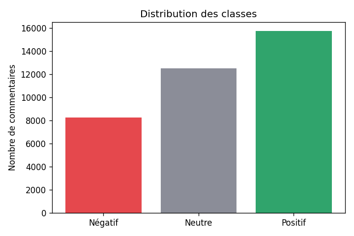
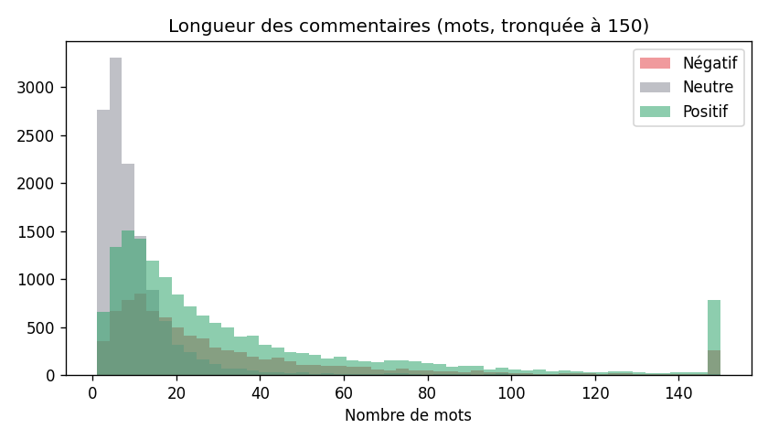
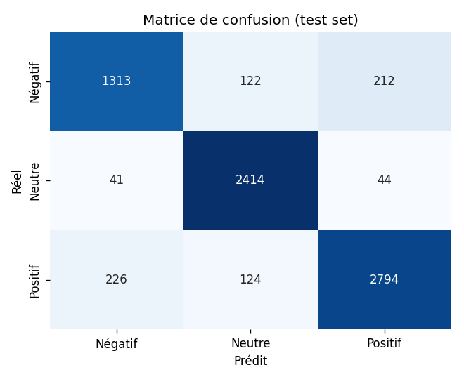
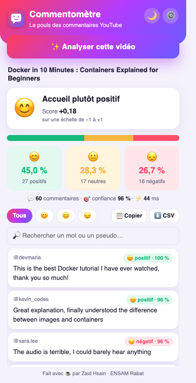
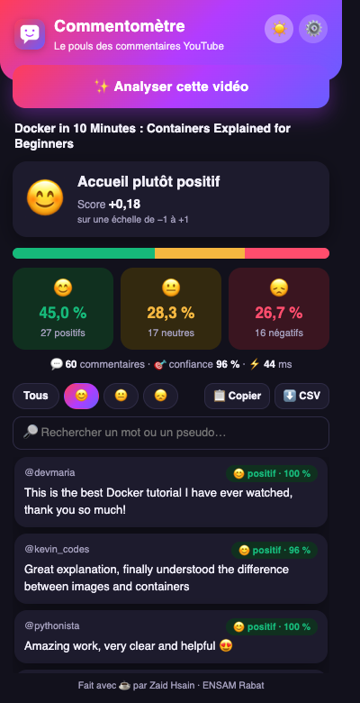

# Analyse de sentiment des commentaires YouTube

Zaid Hsain · Dépôt : {{GITHUB_URL}} · API : {{API_URL}}

---

## Introduction

Quand une vidéo dépasse quelques centaines de commentaires, plus personne ne les lit tous, pas même son auteur. On se contente des premiers, ceux que YouTube met en avant, et on se fait une idée de l'accueil du public à partir d'un échantillon minuscule et pas du tout représentatif. L'objet de ce TP était de construire un outil qui fasse ce travail à notre place : lire les commentaires d'une vidéo et dire, chiffres à l'appui, s'ils sont plutôt positifs, neutres ou négatifs.

Au-delà du modèle lui-même, l'intérêt du sujet est de parcourir toute la chaîne d'un projet de machine learning : préparer des données, entraîner et évaluer un modèle, l'exposer derrière une API, l'emballer dans un conteneur, le mettre en ligne, et enfin le rendre utilisable par quelqu'un qui n'a jamais ouvert un notebook. Ce rapport suit cet ordre. J'y explique ce que j'ai fait, pourquoi je l'ai fait ainsi, et ce qui n'a pas marché du premier coup.

## 1. Architecture générale

Le système se compose de trois blocs qui ne se connaissent que par des interfaces simples.

Le premier est une **extension Chrome**. Quand l'utilisateur est sur une vidéo et clique sur l'icône, un script injecté dans la page récupère le texte des commentaires, le popup l'envoie au serveur, puis affiche le résultat : répartition, score global, liste filtrable.

Le deuxième est une **API REST** écrite avec FastAPI. Elle reçoit une liste de commentaires en JSON et renvoie, pour chacun, une classe et une probabilité, ainsi que des statistiques sur l'ensemble.

Le troisième est le **modèle** : un vectoriseur TF-IDF suivi d'une régression logistique, tous deux sérialisés avec joblib et chargés par l'API au démarrage. L'API tourne dans un conteneur Docker hébergé sur Hugging Face Spaces.

Tableau : Déroulement d'une analyse, du clic à l'affichage

| Étape | Composant | Action |
|---|---|---|
| 1 | Popup | L'utilisateur clique sur « Analyser » |
| 2 | Script de contenu | Défilement de la page, lecture des commentaires dans le DOM |
| 3 | Popup | Envoi par lots de 100 vers `POST /predict_batch` |
| 4 | API | Validation, nettoyage du texte, TF-IDF, `predict_proba` |
| 5 | API | Réponse : classe, confiance, probabilités, statistiques |
| 6 | Popup | Barre de répartition, chiffres clés, liste filtrable |

J'ai tenu à ce que la logique de prédiction (`src/api/predictor.py`) soit indépendante de FastAPI : elle se teste sans serveur, et si je devais changer de framework je n'aurais qu'un fichier à réécrire. Le seul code partagé entre l'entraînement et l'API est la fonction de nettoyage du texte, dans `src/utils/text.py`. J'y reviens en section 9, parce que c'est précisément ce partage qui m'a posé problème.

## 2. Mise en place de l'environnement

### 2.1 Organisation du dépôt

J'ai suivi la structure proposée dans l'énoncé : `data/raw` et `data/processed` pour les données, `models/` pour les artefacts, `src/` découpé en `data`, `models`, `api` et `utils`, puis `chrome-extension/`, `tests/` et `logs/`. Chaque étape du pipeline est un module exécutable (`python -m src.data.preprocess`, `python -m src.models.train`), ce qui permet de tout reproduire à partir d'un clone du dépôt, dans l'ordre, sans rien faire à la main.

La séparation entre `raw` et `processed` n'est pas qu'une question de rangement. Le fichier brut est ma source de vérité et je ne le modifie jamais ; tout ce qui est dans `processed` peut être supprimé et régénéré par script. Si je change une règle de nettoyage, je relance la préparation, et je sais exactement d'où viennent les données sur lesquelles le modèle a été entraîné.

### 2.2 Environnement virtuel et dépendances

Ma machine avait Python 3.15 par défaut, trop récent pour la version de scikit-learn que je voulais utiliser. J'ai donc créé l'environnement virtuel avec `uv` en Python 3.10, la même version que l'image Docker de production. Ce point paraît anodin, mais il ne l'est pas : un modèle sauvegardé avec joblib n'est garanti relisible qu'avec les mêmes versions de scikit-learn et de numpy. Un environnement virtuel sert justement à figer ces versions par projet, sans dépendre de ce qui est installé sur la machine.

J'ai séparé deux fichiers de dépendances. `requirements.txt` contient tout ce qu'il faut pour travailler (pandas, matplotlib, seaborn, pytest…) ; `requirements-prod.txt` ne contient que ce qu'il faut pour servir le modèle, avec des versions exactes.

### 2.3 Ce qui ne va pas dans Git

Le `.gitignore` exclut l'environnement virtuel (plusieurs centaines de mégaoctets, propre à ma machine), les données (régénérables et trop lourdes), les journaux, les caches Python et tout ce qui pourrait contenir un secret, comme un fichier `.env` ou un token Hugging Face. Un token commité par erreur reste dans l'historique même après suppression, il faut alors le révoquer. Les fichiers du modèle, eux, sont versionnés : ils pèsent environ 750 Ko au total et le Space en a besoin pour démarrer. Pour des modèles de plusieurs centaines de mégaoctets, j'aurais utilisé Git LFS ou le Hub de modèles de Hugging Face.

## 3. Les données

### 3.1 Source

Le jeu de données imposé contient 37 249 commentaires Reddit étiquetés −1 (négatif), 0 (neutre) ou 1 (positif). Le script `download_data.py` le télécharge, l'enregistre dans `data/raw/reddit.csv` et affiche quelques statistiques. Cent lignes ont un texte manquant. La répartition est déséquilibrée : 42,5 % de positifs, 35,3 % de neutres, 22,2 % de négatifs.

### 3.2 Nettoyage

Le texte est déjà en minuscules et en partie débarrassé de ses mots vides, mais les commentaires YouTube que l'API recevra en production, eux, seront bruts. J'ai donc écrit une fonction de nettoyage qui doit fonctionner sur les deux : passage en minuscules, suppression des balises HTML, des URL et des mentions `@pseudo`, conservation du mot des hashtags, conversion des emojis en texte, suppression des apostrophes (« don't » devient « dont »), de la ponctuation et des chiffres, réduction des lettres répétées (« soooo » devient « soo »).

Les URL et les mentions sont supprimées parce qu'elles sont presque toutes uniques. Chacune deviendrait une colonne de la matrice TF-IDF, qui ne s'appliquerait qu'à un ou deux commentaires et n'aurait aucun lien avec le sentiment ; au mieux elle encombre le vocabulaire, au pire le modèle s'en sert pour mémoriser des exemples.

Les emojis m'ont fait hésiter. Les supprimer est le plus simple, mais sur YouTube ils portent souvent tout le sentiment d'un commentaire. J'ai choisi de les traduire en mots avec la bibliothèque `emoji` : 😍 devient « smiling face with heart eyes », que le vectoriseur peut exploiter. La limite est que le corpus Reddit en contient très peu, donc le modèle n'a pas beaucoup appris de ces mots-là.

Après nettoyage, suppression des textes vides et des doublons, il reste **36 449 commentaires**.

### 3.3 Exploration

L'observation la plus intéressante concerne la longueur : un commentaire neutre fait 7 mots en médiane, contre 21 pour un positif et 20 pour un négatif. Ce n'est pas surprenant quand on y pense, car un texte court a peu de chances de contenir un mot qui exprime une opinion, mais cela annonce déjà que le modèle aura du mal avec les commentaires longs et nuancés.

### 3.4 Déséquilibre et découpage

Le rapport entre la classe la plus fréquente et la plus rare est d'environ 1,9. C'est un déséquilibre modéré, et je n'ai pas voulu sur-échantillonner les négatifs, ce qui revient à dupliquer des textes. J'ai préféré passer `class_weight="balanced"` au modèle : chaque erreur sur un commentaire négatif coûte simplement plus cher pendant l'entraînement.

J'ai découpé les données en 80 % pour l'entraînement et 20 % pour le test, de façon stratifiée et avec une graine fixe (`random_state=42`). Avec 36 000 exemples, 20 % représentent 7 290 commentaires de test, assez pour que l'accuracy mesurée soit précise à moins d'un point près. Le jeu de test n'a servi qu'une seule fois, à la toute fin ; tous les réglages ont été faits par validation croisée sur le jeu d'entraînement.

## 4. Le modèle

### 4.1 Pourquoi TF-IDF

Un simple comptage de mots (`CountVectorizer`) donne autant de poids à « the » qu'à « terrible ». TF-IDF corrige cela en divisant l'importance d'un mot par sa fréquence dans l'ensemble du corpus : un mot présent partout ne pèse presque rien, un mot rare et caractéristique pèse beaucoup. J'ai ajouté `sublinear_tf=True`, qui remplace le nombre d'occurrences par son logarithme, pour qu'un commentaire répétant dix fois « great » ne compte pas dix fois plus qu'un commentaire qui le dit une fois. La normalisation L2 met enfin tous les commentaires à la même échelle, quelle que soit leur longueur.

### 4.2 Comparaison de plusieurs algorithmes

Avant d'optimiser quoi que ce soit, j'ai entraîné quatre classifieurs sur la même représentation TF-IDF pour voir lequel méritait qu'on s'y attarde.

Tableau : Comparaison des algorithmes sur le jeu de test (même vectoriseur)

| Modèle | Accuracy | F1 macro | F1 le plus faible | Temps d'entraînement |
|---|---|---|---|---|
| SVM linéaire | 0,879 | 0,866 | 0,793 | 1,4 s |
| Régression logistique | 0,877 | 0,866 | 0,798 | 3,3 s |
| Forêt aléatoire | 0,773 | 0,713 | 0,476 | 13,2 s |
| Naive Bayes (complément) | 0,685 | 0,658 | 0,556 | 1,2 s |

La régression logistique et le SVM sont à égalité. J'ai gardé la régression logistique pour une raison pratique : elle donne directement des probabilités, que j'affiche comme indice de confiance dans l'extension, alors que le SVM linéaire ne fournit qu'une distance à la frontière. La forêt aléatoire, de son côté, est mal adaptée à des matrices aussi creuses, où chaque arbre ne voit qu'une poignée de mots utiles.

### 4.3 Optimisation des hyperparamètres

J'ai ensuite lancé un `GridSearchCV` sur le pipeline complet, avec une validation croisée à trois plis et le F1 macro comme critère, pour ne pas favoriser la classe majoritaire. La grille croisait la taille des n-grammes (1, 1-2, 1-3), le nombre maximal de mots retenus (30 000 ou 80 000) et la régularisation `C` (1, 5, 10, 20), soit 24 combinaisons.

La meilleure combinaison utilise **des mots seuls, 30 000 mots et C = 20**, pour un F1 macro de 0,870 en validation croisée. Le paramètre qui pèse le plus est de loin `C` : avec une régularisation forte (C = 1), le modèle néglige les mots rares, qui sont souvent les plus expressifs. Comme la meilleure valeur se trouve au bord de la grille, il y aurait sans doute un peu à gagner en testant au-delà de 20. Le fait que les bigrammes n'apportent rien m'a surpris au départ ; la section 4.5 l'explique.

### 4.4 Résultats

Tableau : Performances du modèle final sur les 7 290 commentaires de test

| Classe | Précision | Rappel | F1 |
|---|---|---|---|
| Négatif | 0,831 | 0,797 | 0,814 |
| Neutre | 0,908 | 0,966 | 0,936 |
| Positif | 0,916 | 0,889 | 0,902 |
| Accuracy globale | | | 0,8945 |

Les trois critères de l'énoncé sont respectés : une accuracy de 89,45 % (80 % demandés), un F1 supérieur à 0,75 pour chaque classe (0,81 au plus bas), et 0,7 ms pour prédire un lot de 50 commentaires (100 ms tolérées).

Dans la matrice de confusion, les lignes sont les vraies classes et les colonnes les prédictions. La diagonale est très nette pour les neutres : 2 414 sur 2 499 sont bien reconnus. Les erreurs se concentrent ailleurs, entre positifs et négatifs (212 négatifs pris pour des positifs, 226 dans l'autre sens). En relisant quelques-uns de ces cas, j'ai surtout trouvé des commentaires longs qui contiennent à la fois des mots positifs et négatifs, et pour lesquels un modèle qui ne voit qu'un sac de mots ne peut pas savoir lequel l'emporte. Les négatifs ont le rappel le plus faible (79,7 %), ce qui est cohérent avec le fait qu'ils sont les moins nombreux.

### 4.5 Ce que le modèle a vraiment appris

En regardant les coefficients du modèle, j'ai eu une surprise. Les mots qui poussent le plus vers « négatif » sont *hate, stupid, other, bad, down, evil, pathetic, worst, wrong, mean, game* ; vers « positif », *more, best, good, lol, great, right, own, many, most, better, kind*. « Hate » ou « great », d'accord, mais « other », « down », « more », « own » ou « many » n'expriment aucune opinion.

Ces mots sont exactement ceux du lexique de polarité de **TextBlob**. J'en conclus que les étiquettes du jeu de données n'ont pas été posées par des humains, mais générées automatiquement par TextBlob. Le modèle n'apprend donc pas à reconnaître un sentiment : il apprend à imiter TextBlob, et il le fait très bien. Cela explique plusieurs choses à la fois : la bonne accuracy (la tâche est presque déterministe), l'inutilité des bigrammes (TextBlob raisonne mot par mot), et des erreurs qui paraissent absurdes, comme « not bad at all » classé négatif.

Je l'ai vérifié sur mes propres exemples pendant les tests de l'extension. « *Disappointing, expected much more depth* » est classé positif, à cause de « more ». « *Dark mode editor theme name?* », une simple question, est classé négatif, parce que « dark » est négatif pour TextBlob. Il faut donc lire le 89 % pour ce qu'il est : un taux d'accord avec TextBlob, pas avec un lecteur humain.

## 5. L'API

### 5.1 Choix de FastAPI

J'aurais pu utiliser Flask, mais FastAPI m'a évité beaucoup de code. En déclarant le format des requêtes avec Pydantic, j'obtiens la validation des entrées, des messages d'erreur précis et une documentation interactive (`/docs`) générée automatiquement, que je n'ai pas eu à écrire. FastAPI repose aussi sur un serveur ASGI (Uvicorn), plus performant que le serveur WSGI classique de Flask.

### 5.2 Points d'entrée

`GET /health` indique si l'API tourne, si le modèle est chargé, sa version et depuis combien de temps le service est démarré. C'est ce que surveillent le `HEALTHCHECK` de Docker et le bouton « Tester l'API » de l'extension.

`POST /predict_batch` accepte de 1 à 500 commentaires. Chaque commentaire est tronqué à 5 000 caractères plutôt que rejeté, car un long commentaire reste analysable. La réponse contient, pour chaque commentaire, le texte d'origine, la classe, l'étiquette, la confiance et les trois probabilités, puis des statistiques globales (effectifs, pourcentages, confiance moyenne, score entre −1 et 1) et le temps de calcul.

Tableau : Codes de réponse de `/predict_batch`

| Code | Situation |
|---|---|
| 200 | Prédiction effectuée |
| 422 | Lot vide, plus de 500 éléments, mauvais type, JSON mal formé |
| 503 | Modèle non chargé |
| 500 | Erreur inattendue (journalisée côté serveur, message générique côté client) |

### 5.3 CORS

Un navigateur interdit par défaut à une page d'interroger un autre domaine que le sien ; c'est la politique de même origine. CORS est le mécanisme par lequel le serveur indique quelles origines il accepte. J'autorise les extensions Chrome (`chrome-extension://…`), `localhost` pour le développement et `youtube.com`, et rien d'autre : un site quelconque ne peut pas se servir de mon API depuis le navigateur de ses visiteurs. CORS ne remplace pas une authentification, puisque `curl` l'ignore complètement, mais ce n'était pas l'objet du TP.

### 5.4 Chargement du modèle

Le modèle est chargé une seule fois, au démarrage, grâce au mécanisme `lifespan` de FastAPI, puis conservé en mémoire. Le recharger à chaque requête ajouterait des dizaines de millisecondes pour rien. Si le chargement échoue, par exemple parce qu'un fichier manque, l'API démarre quand même : `/health` passe à l'état « degraded » et `/predict_batch` répond 503. Je préfère un service qui explique son problème à un conteneur qui redémarre en boucle sans rien dire.

## 6. L'extension Chrome

### 6.1 Récupérer les commentaires

YouTube ne charge pas tous les commentaires d'un coup : ils arrivent par paquets à mesure que l'on fait défiler la page. Le script de contenu fait donc défiler la page jusqu'en bas, attend un peu moins d'une seconde, compte les commentaires, et recommence. Il s'arrête quand il a atteint le nombre demandé (50 à 500, réglable) ou quand quatre tentatives de suite n'ont rien apporté de nouveau, puis remet la page à sa position de départ.

Chaque fil de discussion (`ytd-comment-thread-renderer`) contient le commentaire principal et, si l'utilisateur les a dépliées, ses réponses. Le script les distingue et une case à cocher permet de les inclure. Par défaut, je les laisse de côté : une réponse réagit le plus souvent au commentaire parent, pas à la vidéo, et elle fausserait le bilan.

Il fallait aussi gérer un cas pénible : si l'onglet YouTube était ouvert avant l'installation de l'extension, le script n'y est pas. Le popup le détecte et l'injecte lui-même avec `chrome.scripting`.

### 6.2 Interface

Pour l'interface, j'ai cherché quelque chose de lisible en un coup d'œil. En haut des résultats, un emoji et une phrase résument l'humeur générale (« Accueil plutôt positif », « Le public n'aime pas »…) à partir du score global. En dessous viennent une barre de répartition, trois tuiles avec le pourcentage et l'effectif de chaque classe, puis le nombre de commentaires, la confiance moyenne et le temps de réponse. La liste des commentaires indique pour chacun sa classe et sa confiance ; on peut la filtrer par sentiment ou par mot-clé. Un bouton bascule entre thème clair et sombre (le choix est mémorisé), et deux autres copient le résumé ou exportent les résultats en CSV.

Tableau : Captures de l'extension

| Résultats, thème clair | Filtre « positifs », thème sombre |
|---|---|
|  |  |

Je n'utilise aucune bibliothèque externe : la barre et les tuiles sont faites en HTML et CSS. C'était presque une obligation, car le Manifest V3 interdit de charger du code distant, et embarquer une bibliothèque de graphiques pour une seule barre aurait été disproportionné. Les commentaires sont insérés dans la page avec `textContent` et jamais `innerHTML`, pour qu'un commentaire contenant du HTML ne puisse pas s'exécuter dans l'extension.

### 6.3 Beaucoup de commentaires

Pour qu'un grand nombre de commentaires reste fluide, l'extension les envoie par lots de 100 et affiche la progression. Elle recalcule les statistiques globales de son côté, et construit la liste en mémoire avant de l'insérer d'un seul coup dans la page. Au-delà de quelques milliers de commentaires, il faudrait virtualiser la liste et mettre en cache les résultats par vidéo.

## 7. Conteneurisation et déploiement

### 7.1 Le Dockerfile

L'image part de `python:3.10-slim`, environ 50 Mo au lieu d'un gigaoctet pour l'image complète. Elle crée un utilisateur non administrateur d'identifiant 1000, comme Hugging Face l'exige, et expose le port 7860. L'ordre des instructions compte : je copie d'abord `requirements-prod.txt` et j'installe les dépendances, et seulement ensuite le code. Quand je modifie une ligne de Python, Docker reprend la couche des dépendances depuis son cache au lieu de tout réinstaller. Seuls `src/utils`, `src/api`, `models/` et `app_api.py` entrent dans l'image ; le `.dockerignore` écarte le reste. Un `HEALTHCHECK` interroge `/health` toutes les 30 secondes.

### 7.2 Dépendances de développement et de production

L'image n'a pas besoin de pandas, matplotlib, seaborn ou pytest, qui ne servent qu'à préparer les données, entraîner et tester. Les retirer rend l'image plus petite, plus rapide à construire et à démarrer, et réduit le nombre de paquets à surveiller pour les failles de sécurité. Pour la réduire encore, on pourrait faire un build multi-étapes, ou exporter le modèle au format ONNX pour se passer complètement de scikit-learn.

### 7.3 Mise en ligne et mises à jour

Le même dépôt Git a deux destinations : GitHub pour le code, et le Space Hugging Face, qui reconstruit l'image à chaque `git push`. L'en-tête YAML du README indique au Space d'utiliser Docker sur le port 7860.

Pour mettre à jour le modèle, j'incrémente sa version dans `models/metadata.json`, et cette version est renvoyée par `/health` et dans chaque réponse. Le processus que je suivrais est le suivant : réentraîner, vérifier que les tests passent (ils contrôlent les seuils de performance), comparer au modèle en ligne sur le même jeu de test, puis pousser. Si le build échoue, l'ancienne version reste en ligne, et un `git revert` suffit pour revenir en arrière.

## 8. Tests

Les tests automatiques sont écrits avec pytest et répartis en trois fichiers ; les 38 passent.

Tableau : Contenu des tests automatiques

| Fichier | Ce qui est vérifié |
|---|---|
| `test_preprocessing.py` | URL, mentions, hashtags, emojis, ponctuation, apostrophes, HTML, entrées vides ou non textuelles |
| `test_model.py` | Seuils de l'énoncé sur le jeu de test ; cas évidents ; cas limites (texte vide, très court, emojis seuls, 18 000 caractères, mélange de langues) ; latence ; cohérence des statistiques |
| `test_api.py` | `/health` ; lots de 1 à 500 ; six requêtes invalides (422) ; JSON mal formé ; mauvaise méthode (405) ; CORS accepté pour l'extension et refusé pour une origine inconnue ; temps de réponse ; modèle absent (503) |

Le script `tests/integration_check.py` vise une API réelle, locale ou en ligne. Il vérifie les deux points d'entrée et la gestion d'erreurs, mesure le temps de réponse selon la taille du lot, et contrôle surtout que l'API distante donne exactement les mêmes prédictions que le modèle local. En local, un lot de 50 commentaires fait l'aller-retour en 3 ms et un lot de 500 en 14 ms. Sur Hugging Face, il faut ajouter la latence réseau, et surtout le réveil du Space s'il était en veille, qui peut prendre une trentaine de secondes. C'est pour cela que l'extension patiente jusqu'à 30 secondes avant d'abandonner.

Pour l'extension, j'ai écrit un test de bout en bout avec Playwright (`tests/e2e/run_e2e.py`). Il charge la vraie extension dans Chromium, interroge la vraie API, puis joue tout le scénario : test de connexion, analyse, filtres, recherche, thème sombre, copie, export CSV, option des réponses, et API coupée. YouTube n'affiche pas ses commentaires dans un navigateur automatisé ; le test sert donc à l'adresse `youtube.com/watch` une page qui reproduit leur structure HTML, avec 60 commentaires fictifs qui arrivent par paquets de 20 au défilement, comme sur le vrai site. Tout autre accès à YouTube est bloqué pendant le test.

Tableau : Résultats du test de bout en bout

| Vérification | Résultat |
|---|---|
| Défilement automatique | 60 commentaires sur 60, chargés en trois vagues |
| Durée d'une analyse | Environ 6,5 s, presque entièrement due au défilement |
| Réponses incluses | 63 éléments, dont 3 marqués comme réponses |
| API injoignable | Message clair invitant à vérifier l'URL |
| Justesse | 57 commentaires sur 60 classés comme je l'attendais |

L'essai sur de vraies vidéos, je l'ai fait à la main dans Chrome. C'est aussi ce que montre la vidéo de démonstration.

## 9. Difficultés rencontrées

**La plus instructive** est survenue au moment de préparer l'image Docker. Je n'avais pas Docker sur ma machine, alors j'ai reproduit son contenu exact dans un dossier vide : seulement les fichiers copiés par le Dockerfile, seulement les dépendances de production. L'API a refusé de démarrer avec une erreur `ModuleNotFoundError: pandas`. La fonction de nettoyage vivait dans le même fichier que le script de préparation des données, qui importe pandas en tête. En local, tout fonctionnait puisque pandas était installé. J'ai déplacé la fonction dans un petit module sans dépendance, `src/utils/text.py`, utilisé à la fois par l'entraînement et par l'API. Le nettoyage est donc garanti identique des deux côtés, et l'image n'embarque pas pandas.

**La deuxième** concerne les versions. J'avais commencé en Python 3.11 avec numpy 2.4, qui n'existe pas pour Python 3.10, la version imposée pour l'image. Un modèle entraîné avec une version et rechargé avec une autre risquait de ne pas se charger, ou de se charger avec un comportement différent. J'ai recréé l'environnement en 3.10 et réentraîné le modèle (les résultats sont identiques), puis figé les versions de production sur celles de l'entraînement.

**Les autres** étaient plus terre à terre. Le port 8000 était déjà pris par un autre service sur ma machine, donc je développe sur le 8001. `localhost` était résolu en IPv6 alors que le conteneur écoutait en IPv4, et `127.0.0.1` a réglé le problème. Enfin, la politique de sécurité des extensions empêche d'évaluer du code dans le popup, ce qui m'a obligé à réécrire certaines attentes du test Playwright.

## 10. Limites et perspectives

La limite principale tient aux données plus qu'au modèle. Tant que les étiquettes viennent de TextBlob, aucun modèle entraîné dessus ne fera mieux que TextBlob. La première chose à faire serait d'annoter à la main quelques milliers de vrais commentaires YouTube, en anglais mais aussi en français et en darija, puisque ce sont les langues que je croise le plus. Il faudrait aussi traiter explicitement les négations, en fusionnant par exemple « not » avec le mot suivant, puis essayer un petit modèle de type transformer (DistilBERT, ou XLM-R pour le multilingue), exporté en ONNX pour rester rapide.

Côté industrialisation, il manque une intégration continue qui lancerait les tests et reconstruirait l'image à chaque modification, un suivi des expériences (MLflow) et des données (DVC), une clé d'API avec limitation du nombre d'appels, et une surveillance de la dérive des données en production. Pour l'extension, passer par l'API officielle YouTube Data v3 permettrait de récupérer tous les commentaires sans faire défiler la page, et d'ajouter une évolution du sentiment dans le temps.

## Conclusion

Le système fonctionne de bout en bout. Un clic sur une vidéo suffit pour lire ses commentaires, les envoyer au modèle et afficher un bilan en quelques secondes, et le modèle dépasse les trois seuils fixés par l'énoncé. Ce que je retiens surtout du TP, cependant, ce sont deux leçons qui ne figuraient pas dans le sujet. La première : un bon score ne veut rien dire tant qu'on ne sait pas d'où viennent les étiquettes. La seconde : « ça marche sur ma machine » ne prouve pas grand-chose tant qu'on n'a pas essayé dans un environnement aussi dépouillé que la production.
